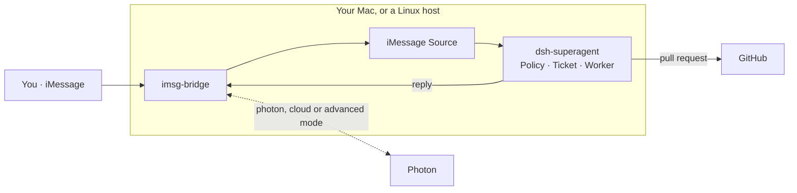

<p align="center">
  
</p>

<h1 align="center">superagent-imessage</h1>

<p align="center">
  <b>Text in iMessage to control your repository.</b><br>
  <sub>Ask a coding agent for work in iMessage; it answers in the same chat, with a pull request.</sub>
</p>

<p align="center">
  <a href="https://github.com/deepseek-ai/dsh-superagent-prototype"></a>
  <a href="https://photon.codes/spectrum"></a>
  
  
  <a href="LICENSE"></a>
</p>

<p align="center">
  <a href="SETUP.md"><b>Setup</b></a> &nbsp;·&nbsp;
  <a href="docs/009-imessage.md">iMessage</a> &nbsp;·&nbsp;
  <a href="docs/000-philosophy.md">Philosophy</a> &nbsp;·&nbsp;
  <a href="https://github.com/wiva-hq/superagent-imessage/issues/new">Report an issue</a>
</p>

> **Experimental.** A Wiva experiment, not an official DeepSeek project and not affiliated with DeepSeek. It builds on a research prototype whose DeepSeek Harness dependencies are alpha releases. The iMessage code was written with Claude Code and reviewed by the Wiva team. Review it before you run it.

---

## Why superagent-imessage

<table>
  <tr>
    <td width="33%" valign="top"><b>💬 Text, don't tab</b><br><sub>A direct message, or <code>@agent</code> in a group chat. Follow-ups in the same chat reach the same work.</sub></td>
    <td width="33%" valign="top"><b>🙋 AI proposes; people choose</b><br><sub>The agent answers with a pull request for a person to review. Work nobody asked for starts in a mode that only records it.</sub></td>
    <td width="33%" valign="top"><b>🔒 Only who you allow</b><br><sub>Anyone can text an Apple ID, so direct messages start off and only listed phone numbers and emails may ask for work.</sub></td>
  </tr>
  <tr>
    <td valign="top"><b>💻 Mac or no Mac</b><br><sub>Your own Apple ID in Messages on a Mac, or a Photon line (v2, Spectrum or Advanced iMessage) on any Linux host.</sub></td>
    <td valign="top"><b>✉️ One reply, never two</b><br><sub>The bridge keeps a ledger, so retries post a reply at most once and never lose it.</sub></td>
    <td valign="top"><b>🔁 Deploys itself</b><br><sub>A deploy script backs up the database, restarts, and rolls back when the new version won't start.</sub></td>
  </tr>
</table>

## See it work

A real run, on 2 November 2026: a phone texting a shared Photon v2 line, with the agent working on
[a public ROS 2 repository](https://github.com/Ltcc0/ros2-turtlesim-magic-button) and the DeepSeek model of the
operator's account.

| Time (UTC) | | Message |
| --- | --- | --- |
| 05:58:35 | 📱 You | please add a README.md to this repo with one line: Hello from iMessage |
| 05:58:41 | 🤖 Agent | On it: adding a README.md to this repo containing the single line “Hello from iMessage”. |
| 05:59:19 | 🤖 Agent | PR #1 https://github.com/Ltcc0/ros2-turtlesim-magic-button/pull/1 is ready for review: it adds a root README.md with the single line “Hello from iMessage”. It needs a person to merge it. |

Six seconds to acknowledge, 44 to [a pull request](https://github.com/Ltcc0/ros2-turtlesim-magic-button/pull/1)
that adds exactly that file and line, left for a person to merge. A plain “Hello from iMessage” sent a minute before
was judged a greeting with nothing to do, so the agent stayed silent: it speaks only when someone asked for something.

## Built on

This repository adds about a thousand lines. Everything that makes it an agent comes from two open-source projects, both MIT:

| | What it gives this project | Without it |
|---|---|---|
| **[dsh-superagent](https://github.com/deepseek-ai/dsh-superagent-prototype)** by DeepSeek, on **[DeepSeek Harness](https://github.com/deepseek-ai/deepseek-harness)** | The whole agent: Sources, the Policy that decides who may ask, Tickets, worker sessions that write code and open pull requests, the Outbox that retries replies, the web panel, the prompts and the guided setup. iMessage plugs in as one more Source, next to GitHub and Feishu. | An agent runtime, authorization and execution to build from scratch |
| **[imessage-kit](https://github.com/photon-hq/imessage-kit)** by Photon | Reads `chat.db` and sends through Messages.app on a Mac, with typed messages and chats | Parsing Apple's private database and scripting Messages by hand |
| **[Spectrum](https://photon.codes/spectrum)** by Photon | An iMessage line in the cloud, so the agent runs on Linux with no Mac to keep logged in | No way to run iMessage off a Mac |
| **[Photon v2](https://photon.codes/docs/beta/photon.md)** | An iMessage line behind one HTTPS API with a project key: stored messages, chats and idempotent sends, so nothing runs beside the agent and no message is lost while it is down | A process to keep the line open, and a local journal and ledger |
| **[Advanced iMessage](https://github.com/photon-hq/advanced-imessage-ts)** by Photon | A line whose server keeps the history and a durable event log, with sends deduplicated server-side, so nothing runs beside the agent and no message is lost while it is down | A process to keep the line open, and a local journal and ledger |

## How it works



**`imsg-bridge`** reads and sends iMessage: on a Mac through Messages, or anywhere through a Photon line: Photon v2
(called directly over HTTPS), Spectrum (with `imsg-bridge serve` keeping it open) or Advanced iMessage (over gRPC). The **iMessage Source** turns each message into a Trigger; **dsh-superagent** checks it
against the allowed list, opens a Ticket, works on it in its own session, and replies in the chat.

## Get started

**1 · Set up dsh-superagent** with your coding agent: ask it to *read SETUP.md in this repository and set up
dsh-superagent with me*. It asks one question at a time, then installs and configures everything.

**2 · Install the bridge** and choose a mode ([details](docs/009-imessage.md)):

```sh
(cd bridge && pnpm install --frozen-lockfile)
bridge/bin/imsg-bridge chats --json                                   # local: lists your Mac's chats
IMSG_BRIDGE_MODE=cloud PHOTON_PROJECT_ID=… PHOTON_PROJECT_SECRET=… \
  bridge/bin/imsg-bridge serve                                        # cloud: keeps the Spectrum line open
IMSG_BRIDGE_MODE=photon PHOTON_PROJECT_ID=pho_prj_… PHOTON_API_KEY=… \
  bridge/bin/imsg-bridge chats --json                                 # photon: lists the line's chats (Photon v2)
IMSG_BRIDGE_MODE=advanced PHOTON_IMESSAGE_ADDRESS=… PHOTON_IMESSAGE_TOKEN=… \
  bridge/bin/imsg-bridge chats --json                                 # advanced: lists the line's chats
```

**3 · Turn on the Source.** Enable `dsh-superagent-imessage` in the profile, then in **Settings → Sources → iMessage**
pick the chats, and under **Eval → On each Source → iMessage** list who may ask.

Every build is on [Releases](https://github.com/wiva-hq/superagent-imessage/releases).

## Security, in short

The agent acts only for the people you list, direct messages start off, and it answers with pull requests, not
merges. It runs as your user with your Messages account, so keep the host to yourself, and keep any self-hosted
deploy runner on a private repository. In the Photon modes, messages pass through Photon. Read
[002 Authorization](docs/002-authorization.md) and the deploy notes in [009 iMessage](docs/009-imessage.md).

## Documentation

Read the numbered documents in order; each builds only on the ones before it.

[000 Philosophy](docs/000-philosophy.md) · [001 Domain model](docs/001-domain.md) · [002 Authorization](docs/002-authorization.md) ·
[003 Execution](docs/003-execution.md) · [004 Prompts](docs/004-prompts.md) · [005 Panel](docs/005-panel.md) ·
[006 Deployment](docs/006-deployment.md) · [007 Architecture](docs/007-architecture.md) · [008 Cookbook](docs/008-cookbook.md) ·
[009 iMessage](docs/009-imessage.md)

## Development

```sh
pnpm install && pnpm check             # the bundle: typecheck, tests, build
cd bridge && pnpm install && pnpm check  # imsg-bridge: typecheck, tests
```

| | |
|---|---|
| [`src/sources/imessage*.ts`](src/sources) | The iMessage Source, built by the recipe in [008 Cookbook](docs/008-cookbook.md) |
| [`bridge/`](bridge) | `imsg-bridge`: local mode with imessage-kit, cloud mode with Spectrum, advanced mode with Advanced iMessage, photon mode with Photon v2 |
| [`src/`](src) | dsh-superagent from DeepSeek: Sources, Policy, Tickets, execution, the panel |
| [`prompts/`](prompts) | The agent's prompts |
| [`scripts/`](scripts) | `dsh-superagent` (start, stop, status) and `deploy-mac.sh` |

Bug reports, ideas and pull requests are welcome; see [CONTRIBUTING.md](CONTRIBUTING.md) for how a pull request
lands, with you credited as a co-author.

---

<p align="center"><sub>
  <a href="LICENSE">MIT License</a> · made by <a href="https://wiva.io"> <b>Wiva, Inc.</b></a> · built on <a href="https://github.com/deepseek-ai/dsh-superagent-prototype">dsh-superagent</a> by DeepSeek and iMessage SDKs by <a href="https://photon.codes">Photon</a>
</sub></p>
