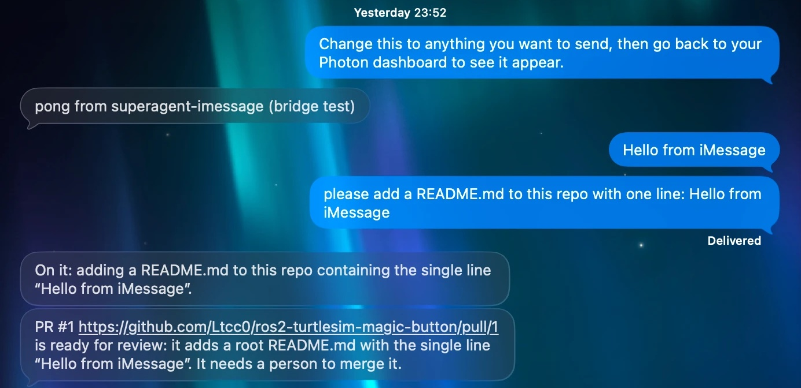
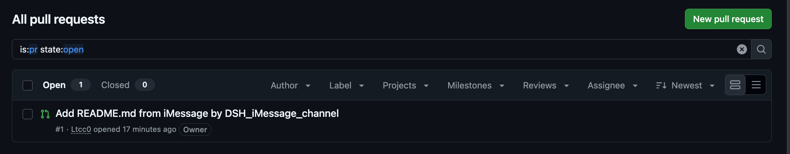
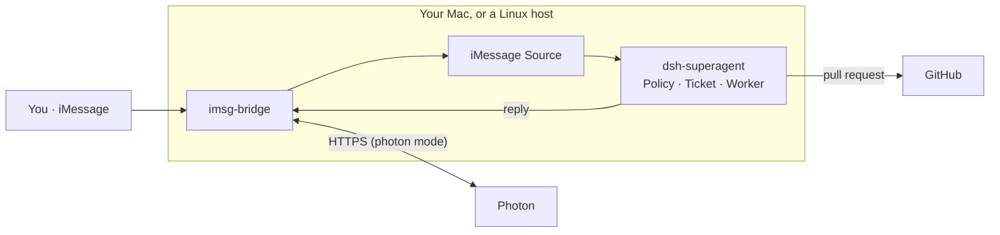

<p align="center">
  
</p>

<h1 align="center">superagent-imessage</h1>

<p align="center">
  <b>Text in iMessage to control your repository.</b><br>
  <sub>Ask a coding agent for work in iMessage; it answers in the same chat, with a pull request.</sub>
</p>

<p align="center">
  <a href="https://github.com/deepseek-ai/dsh-superagent-prototype"></a>
  <a href="https://photon.codes/docs/beta/photon.md"></a>
  <a href="https://github.com/deepseek-ai/deepseek-harness"></a>
  
  
  <a href="LICENSE"></a>
</p>

<p align="center">
  <a href="SETUP.md"><b>Setup</b></a> &nbsp;·&nbsp;
  <a href="docs/009-imessage.md">iMessage</a> &nbsp;·&nbsp;
  <a href="docs/000-philosophy.md">Philosophy</a> &nbsp;·&nbsp;
  <a href="https://github.com/wiva-hq/superagent-imessage/issues/new">Report an issue</a>
</p>

> **Experimental.** A Wiva experiment, not an official DeepSeek project and not affiliated with DeepSeek. It builds on a research prototype whose DeepSeek Harness dependencies are alpha releases, and Photon v2 is in beta. The iMessage code was written with Claude Code and reviewed by the Wiva team. Review it before you run it.

---

## Why superagent-imessage

<table>
  <tr>
    <td width="33%" valign="top"><b>💬 Text, don't tab</b><br><sub>A direct message, or <code>@agent</code> in a group chat. Follow-ups in the same chat reach the same work.</sub></td>
    <td width="33%" valign="top"><b>🙋 AI proposes; people choose</b><br><sub>The agent answers with a pull request for a person to review. Work nobody asked for starts in a mode that only records it.</sub></td>
    <td width="33%" valign="top"><b>🔒 Only who you allow</b><br><sub>Anyone can text an Apple ID, so direct messages start off and only listed phone numbers and emails may ask for work.</sub></td>
  </tr>
  <tr>
    <td valign="top"><b>💻 Mac or no Mac</b><br><sub>A Photon v2 line from any Mac or Linux host, or your own Apple ID in Messages on a Mac.</sub></td>
    <td valign="top"><b>✉️ One reply, never two</b><br><sub>Every reply carries a key Photon deduplicates (or the bridge does, on a Mac), so retries post it at most once and never lose it.</sub></td>
    <td valign="top"><b>🔑 Keys stay out of the service</b><br><sub>Credentials live in one file only your user can read, never in the service's environment or its workers'.</sub></td>
  </tr>
</table>

## See it work

A real run, on 2 November 2026: a phone texting a shared Photon v2 line, with the agent working on
[a public ROS 2 repository](https://github.com/Ltcc0/ros2-turtlesim-magic-button) and the DeepSeek model of the
operator's account.

<p align="center">
  
</p>
<p align="center">
  
</p>

Six seconds to acknowledge, 44 to [a pull request](https://github.com/Ltcc0/ros2-turtlesim-magic-button/pull/1)
that adds exactly that file and line, left for a person to merge. A plain “Hello from iMessage” sent a minute before
was judged a greeting with nothing to do, so the agent stayed silent: it speaks only when someone asked for something.

<details>
<summary>The messages, as the line recorded them</summary>

| Time (UTC) | | Message |
| --- | --- | --- |
| 05:58:35 | 📱 You | please add a README.md to this repo with one line: Hello from iMessage |
| 05:58:41 | 🤖 Agent | On it: adding a README.md to this repo containing the single line “Hello from iMessage”. |
| 05:59:19 | 🤖 Agent | PR #1 https://github.com/Ltcc0/ros2-turtlesim-magic-button/pull/1 is ready for review: it adds a root README.md with the single line “Hello from iMessage”. It needs a person to merge it. |

</details>

## Choose a mode

`imsg-bridge` reaches iMessage in one of four ways. The Source can't tell them apart, so switching is one line in
`bridge.env`.

| Mode | The line | Needs | Status |
| --- | --- | --- | --- |
| **`photon`** (recommended) | A shared or dedicated line in a [Photon v2](https://photon.codes/docs/beta/photon.md) project | A project id and API key | ✅ Verified end to end on a shared line ([See it work](#see-it-work)) |
| `local` | Your own Apple ID in Messages | A Mac that stays logged in, Full Disk Access | Tested against fakes |
| `cloud` | A [Photon Spectrum](https://photon.codes/spectrum) line | `imsg-bridge serve` running beside the service | Tested against fakes |
| `advanced` | A [Photon Advanced iMessage](https://github.com/photon-hq/advanced-imessage-ts) server | Its address and token | Tested against fakes |

On a shared Photon line, the agent can reply only to people who texted the line first; a dedicated line has no such
limit. [009 iMessage](docs/009-imessage.md) compares the modes in full.

## Built on

This repository adds about 1,200 lines: the iMessage Source and `imsg-bridge`. Everything that makes it an agent, and
every way it reaches iMessage, comes from open-source projects, all MIT:

| | What it gives this project | Without it |
|---|---|---|
| **[dsh-superagent](https://github.com/deepseek-ai/dsh-superagent-prototype)** by DeepSeek, on **[DeepSeek Harness](https://github.com/deepseek-ai/deepseek-harness)** | The whole agent: Sources, the Policy that decides who may ask, Tickets, worker sessions that write code and open pull requests, the Outbox that retries replies, the web panel, the prompts and the guided setup. iMessage plugs in as one more Source, next to GitHub and Feishu. | An agent runtime, authorization and execution to build from scratch |
| **[Photon v2](https://photon.codes/docs/beta/photon.md)** | An iMessage line behind one HTTPS API with a project key: stored messages and chats, and idempotent sends, so nothing runs beside the agent and no message is lost while it is down | A Mac to keep logged in, or a process holding the line open |
| **[imessage-kit](https://github.com/photon-hq/imessage-kit)** by Photon | Reads `chat.db` and sends through Messages.app on a Mac, with typed messages and chats | Parsing Apple's private database and scripting Messages by hand |
| **[Spectrum](https://photon.codes/spectrum)** and **[Advanced iMessage](https://github.com/photon-hq/advanced-imessage-ts)** by Photon | The other Photon lines, over a held connection or gRPC | No way to run iMessage off a Mac without Photon v2 |

## How it works



The **iMessage Source** asks **`imsg-bridge`** for new messages every 5 seconds and turns each one into a Trigger.
**dsh-superagent** checks it against the allowed list, has the model judge whether it asks for work, opens a Ticket,
and works on it in its own session and git worktree. Replies, from the first “On it” to the pull request's link, go back
through the bridge into the same chat. In photon mode the bridge is a short command that calls Photon's API: nothing
else runs beside the service.

## Get started

You need Node.js 22.19+, pnpm, tmux, the GitHub CLI and [DeepSeek Harness](https://github.com/deepseek-ai/deepseek-harness)
`0.2.1-rc.3` with a model it can use, and an iMessage line in a [Photon v2](https://app.beta.photon.codes) project.

**1 · Set up dsh-superagent** with your coding agent: ask it to *read SETUP.md in this repository and set up
dsh-superagent with me*. It asks one question at a time, then installs and configures everything, GitHub included.

**2 · Give the bridge the line.** DeepSeek Harness strips variables named like `KEY` or `SECRET` from the commands it
runs, so the bridge reads its credentials from a file only you can read:

```sh
(cd bridge && pnpm install --frozen-lockfile)
ln -s "$PWD/bridge/bin/imsg-bridge" ~/.local/bin/imsg-bridge          # any directory on the service's PATH
mkdir -p ~/.imsg-bridge && read -s "key?Photon API key: " && echo &&            # zsh; in bash: read -sp "…" key
  printf 'IMSG_BRIDGE_MODE=photon\nPHOTON_PROJECT_ID=pho_prj_…\nPHOTON_API_KEY=%s\n' "$key" > ~/.imsg-bridge/bridge.env &&
  chmod 600 ~/.imsg-bridge/bridge.env && unset key
imsg-bridge chats --json                                              # text the line first: this lists the chat
```

**3 · Turn on the Source.** Add `- id: dsh-superagent-imessage` with `disabled: false` to the profile's
`cordis.patch.yml` and restart. Under **Eval → On each Source → iMessage**, list the phone numbers or emails that may
ask for work; then, in **Settings → Sources → iMessage**, turn on direct messages or pick group chats. Text the line.

The other modes are set up in [009 iMessage](docs/009-imessage.md). Every build is on
[Releases](https://github.com/wiva-hq/superagent-imessage/releases).

## Security, in short

The agent acts only for the people you list, direct messages start off, and it answers with pull requests, not
merges. Credentials stay in `~/.imsg-bridge/bridge.env`, which the bridge refuses unless only your user can read it, and
never enter the service's environment. Workers run as your user, so this keeps keys out of environments and logs,
not out of a determined worker's reach: the allowed list is the boundary. In the Photon modes, messages pass through Photon; in local mode the agent uses
your Messages account, so keep that host to yourself. Read [002 Authorization](docs/002-authorization.md) and the
Credentials and deploy notes in [009 iMessage](docs/009-imessage.md).

## Documentation

Read the numbered documents in order; each builds only on the ones before it.

[000 Philosophy](docs/000-philosophy.md) · [001 Domain model](docs/001-domain.md) · [002 Authorization](docs/002-authorization.md) ·
[003 Execution](docs/003-execution.md) · [004 Prompts](docs/004-prompts.md) · [005 Panel](docs/005-panel.md) ·
[006 Deployment](docs/006-deployment.md) · [007 Architecture](docs/007-architecture.md) · [008 Cookbook](docs/008-cookbook.md) ·
[009 iMessage](docs/009-imessage.md)

## Development

```sh
pnpm install && pnpm check             # the bundle: typecheck, tests, build
cd bridge && pnpm install && pnpm check  # imsg-bridge: typecheck, tests
```

| | |
|---|---|
| [`src/sources/imessage*.ts`](src/sources) | The iMessage Source, built by the recipe in [008 Cookbook](docs/008-cookbook.md) |
| [`bridge/`](bridge) | `imsg-bridge`: `photon.ts` (Photon v2), `bridge.ts` (local, imessage-kit), `cloud.ts` and `serve.ts` (Spectrum), `advanced.ts` (Advanced iMessage), `cli.ts` (commands and `bridge.env`) |
| [`src/`](src) | dsh-superagent from DeepSeek: Sources, Policy, Tickets, execution, the panel |
| [`prompts/`](prompts) | The agent's prompts |
| [`scripts/`](scripts) | `dsh-superagent` (start, stop, status) and `deploy-mac.sh`, which backs up the database, restarts and rolls back a failed deploy |

Bug reports, ideas and pull requests are welcome; see [CONTRIBUTING.md](CONTRIBUTING.md) for how a pull request
lands, with you credited as a co-author.

---

<p align="center"><sub>
  <a href="LICENSE">MIT License</a> · made by <a href="https://wiva.io"> <b>Wiva, Inc.</b></a> · built on <a href="https://github.com/deepseek-ai/dsh-superagent-prototype">dsh-superagent</a> by DeepSeek and iMessage SDKs by <a href="https://photon.codes">Photon</a>
</sub></p>
